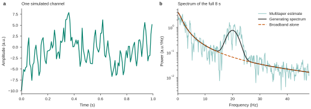
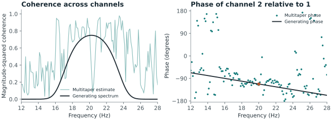
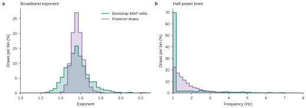

# SL_GPsim

SL_GPsim generates stationary Gaussian recordings from a power spectrum. Give it a cross-spectrum to simulate several channels together. If you already have a recording, you can estimate its spectrum and use it to bootstrap band power, a fitted peak, or another statistic.

## Install

You’ll need Git and mamba. If you don’t have mamba, install [Miniforge](https://conda-forge.org/download/) for your operating system and open a fresh terminal. On Windows, use the Miniforge Prompt.

```bash
git clone --branch feature/cross-spectral-bootstrap https://github.com/Stephen-Lab-BU/SL_GPsim.git
cd SL_GPsim
mamba env create -f environment.yml
conda activate sl-gpsim-bootstrap
python -m pip install --no-deps --no-build-isolation -e .
python examples/simulate_spectra.py
```

Figures use Arial when it is installed. On systems without Arial, Matplotlib uses the first installed sans-serif fallback.

The last command prints the dimensions of two example recordings. Look for `(1024, 1)` and `(1024, 2)`. The examples below run in order in a Python session or notebook using that environment.

## Simulate eight seconds with a 20 Hz rhythm

Choose a sampling rate in Hz and a duration in seconds. Build the generating spectrum by adding a Gaussian peak to a broadband background with a knee.

```python
from SL_GPsim import Broadband, GaussianPeak, SpectralGrid, multitaper_csd

grid = SpectralGrid(fs=128, duration=8)
background = Broadband(scale=8, exponent=1.6, knee=2)
beta = GaussianPeak(center_hz=20, sigma_hz=1.8, height=0.70)
model = background + beta

x = grid.simulate(model, random_state=7)       # (time, channel)
f, S = multitaper_csd(x, fs=grid.fs)          # (frequency, channel, channel)
```

Here `knee=2` is the coefficient in `8 / (2 + f**1.6)`. The background falls to half its zero-frequency value at about 1.54 Hz. To set that frequency directly, use `knee_hz=1.54` in place of `knee=2`. Peak height is additive power per Hz, and `sigma_hz` is the standard deviation.



The model is also a function. Evaluate it at any frequencies to draw a smooth reference curve. The multitaper estimate uses the full eight seconds, three DPSS tapers and time–half-bandwidth product 2.

```python
import matplotlib.pyplot as plt
import numpy as np
from SL_GPsim.figure_style import FIGURE_STYLE

hz = np.linspace(0.125, 48, 2000)
with plt.rc_context(FIGURE_STYLE):
    fig, ax = plt.subplots()
    ax.semilogy(f[1:-1], S[1:-1, 0, 0].real, alpha=0.55, label="Multitaper")
    ax.semilogy(hz, model(hz), color="black", label="Generating spectrum")
    ax.set(xlim=(0, 48), xlabel="Frequency (Hz)", ylabel="Power per Hz")
    ax.legend()
    plt.show()
```

## Give two channels a shared rhythm

Keep an independent background in each channel. Add the same beta source to both, with a smaller amplitude and a two-sample delay in the second channel.

```python
from SL_GPsim import Independent, Shared

channel_two = (Broadband(scale=5.4, exponent=1.4, knee=4)
               + GaussianPeak(center_hz=10, sigma_hz=1.1, height=0.44))
pair = (Independent(background, channel_two)
        + Shared(beta, gains=[1, 0.7], delays_seconds=[0, 2 / grid.fs]))

xy = grid.simulate(pair, random_state=112)
f, C = multitaper_csd(xy, fs=grid.fs)
S20 = pair(20)                                # generating 2 × 2 matrix at 20 Hz
print(np.angle(S20[1, 0], deg=True))          # -112.5 degrees
```



The diagonal entries are the channel power spectra. The off-diagonal entry `C[:, 1, 0]` carries the phase of channel 2 relative to channel 1. At 20 Hz the delay is 15.625 ms, or 112.5° of lag. Far from the shared rhythm, coherence is low in the generating model and the estimated phase scatters.

## Bootstrap a measurement from a recording

This function integrates 15–25 Hz power for each channel. Replace `xy` with your own array of shape `(samples, channels)` and set `fs` to its sampling rate. A single-channel vector works too.

```python
from SL_GPsim import spectral_bootstrap

def beta_power(f, csd):
    band = (f >= 15) & (f < 25)
    channel_power = csd.diagonal(axis1=1, axis2=2).real
    return channel_power[band].sum(axis=0) * (f[1] - f[0])

result = spectral_bootstrap(xy, fs=128, statistic=beta_power,
                            n_resamples=999, random_state=8)
print(np.column_stack((result.estimate, result.lower, result.upper)))
```

With the seeds above, channel 1 gives 3.72 (95% interval 2.73–4.92) and channel 2 gives 2.33 (1.73–3.01), in squared signal units. Each row of `result.draws` holds the two measurements from one simulated recording, so you can also calculate paired contrasts. By default the observed multitaper cross-spectrum supplies the generating model. The interval describes sampling variability under that stationary Gaussian model.

## Compare a decomposition with its bootstrap refits

Install the optional fitters in the same environment. This example fits specparam in knee mode and an additive SL_specdecomp model by MAP to the same 3–45 Hz estimates.

```bash
python -m pip install -r examples/requirements-decomposition.txt
python examples/bootstrap_decomposition.py --draws 99
```

The script prints an estimate, interval and valid-fit count for each parameter. If a replicate has no detected beta peak, the peak interval uses the replicates that detected one. The [fitting function](examples/bootstrap_decomposition.py) shows how to plug your own estimator into the same loop.



The teal histograms show MAP estimates from 999 regenerated recordings. The purple histograms show 6,000 posterior draws conditioned on the original recording. For the half-power knee, the bootstrap interval is 1.00–5.34 Hz and the equal-tailed posterior interval is 1.02–3.32 Hz. Many MAP refits land on the 1 Hz fit bound. The bounds use all draws, including values beyond the displayed range.

<details>
<summary>Reproduce the parameter comparison and Figure 5</summary>

From the repository root with the optional fitters installed, run these scripts in order. They write the simulated spectra, refits, posterior draws, convergence diagnostics and figures to `examples/out/`.

```bash
python examples/workflow_data.py
python examples/workflow_posterior.py
python examples/workflow_summary.py
python examples/workflow_figures.py
```

The [Figure 5 experiment](examples/figure5_data.py) varies the height of an 8 Hz rhythm while holding the broadband fixed. It generates 30 independent records per height. The analysis compares the inferred 40–60 Hz broadband slope across records and estimates uncertainty within individual records. These are new fits of the paper’s design on a common 1–200 Hz fitting band. Run the full set of panels in Bash.

```bash
export OPENBLAS_NUM_THREADS=1 OMP_NUM_THREADS=1
python examples/figure5_data.py controls
for level in 0 1 2 3; do
  for step in population bootstrap posterior_add posterior_mul; do
    python examples/figure5_data.py "$step" --level "$level"
  done
  for rep in {1..29}; do
    python examples/figure5_data.py bootstrap_spec --level "$level" --rep "$rep"
  done
done
python examples/figure5_figures.py
```

Open `examples/out/figure5/Figure5_bootstrap.pdf` for the across-record estimates, within-record bootstrap and posterior shapes, and fits to the exact generating spectra.

</details>

<details>
<summary>Custom spectra, DC and Nyquist</summary>

For a smooth scalar power-density formula, use `grid.density(function)` before passing the resulting array to `grid.simulate`. For a built-in model, `grid.sample(model)` gives the simulation bins directly. Both helpers halve the one-sided density at DC and at Nyquist on even FFT grids. A raw FFT-grid array must already include those weights. Cross-spectral matrices must be Hermitian positive semidefinite, with real entries at DC and even-grid Nyquist. SpectralGrid warns when a peak overlaps a boundary or is narrower than a simulation bin.

Save `model.parameters` as JSON. Pass the decoded dictionary to `SL_GPsim.model_from_parameters` to recover the callable spectrum.

</details>

<details>
<summary>Exact environments, tests and paper version</summary>

[Platform locks](locks/) are provided for Linux x86-64, Apple Silicon and Intel macOS. For an exact base environment, choose the matching lock below (the example uses Linux). The macOS locks were solved for macOS 14. The test suite has been run on Linux.

```bash
mamba create -n sl-gpsim-locked --file locks/linux-64.txt
conda activate sl-gpsim-locked
python -m pip install --only-binary=:all: --no-deps --require-hashes -r locks/pip-wheels.txt
python -m pip install --no-deps --no-build-isolation -e .
python -m pytest -q
```

The [tests](tests/) check finite-record covariance, the sign of cross-channel delays, multitaper normalization and bootstrap moments against analytic or independent numerical references. The [paper release](https://github.com/Stephen-Lab-BU/SL_GPsim/releases/tag/SL_specdecomp-paper) contains the original simulator and its environment.

</details>
